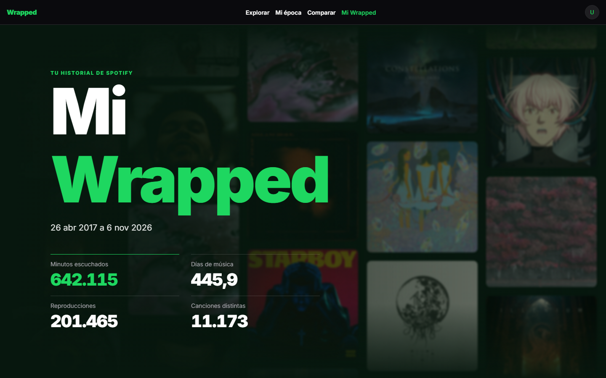
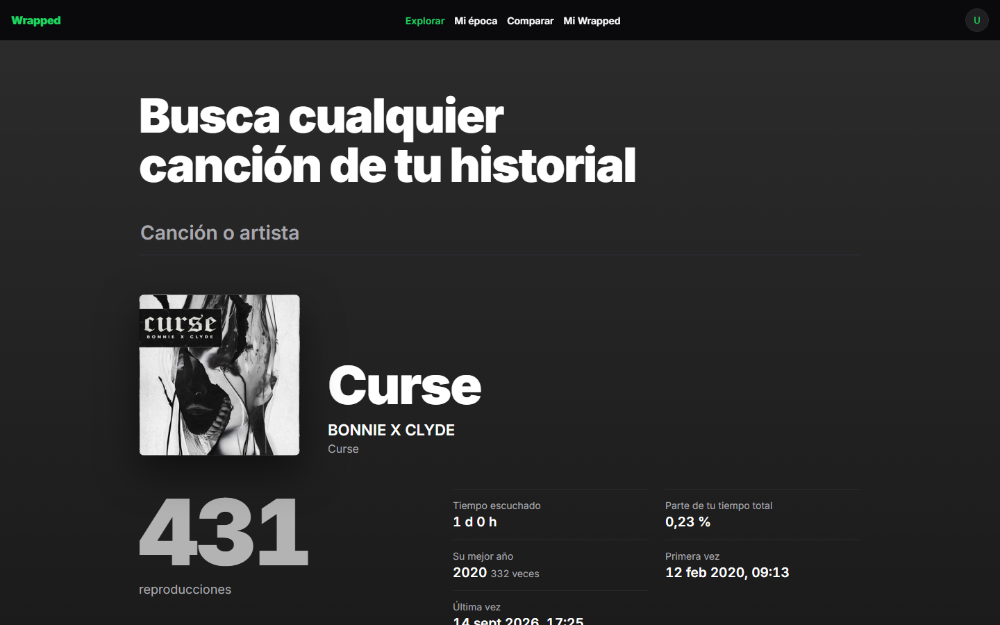
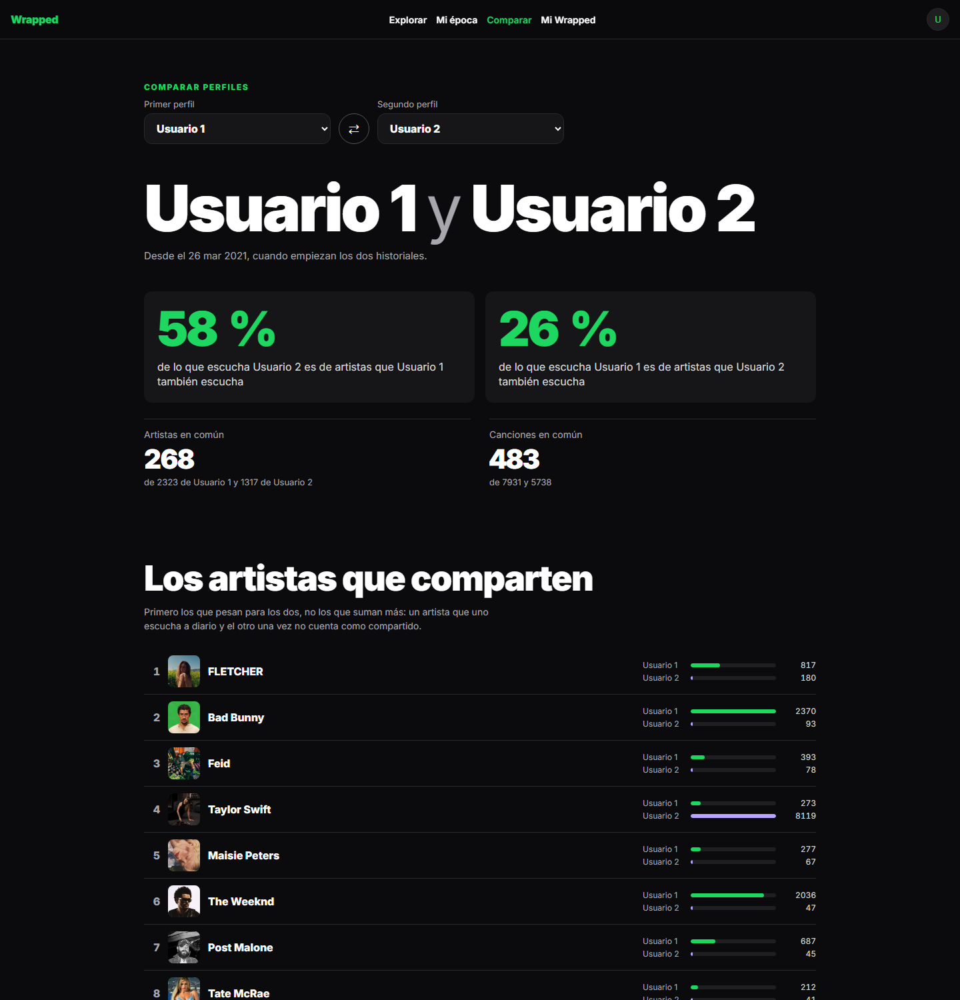
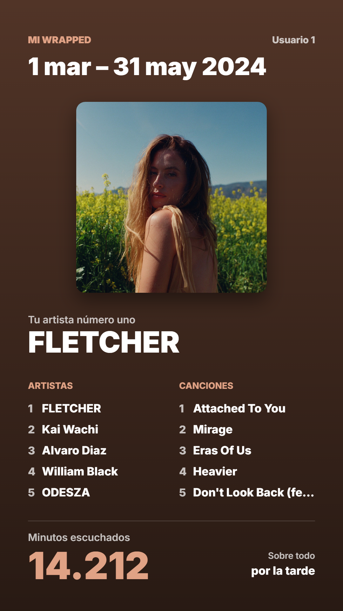
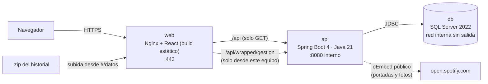

# Mi Spotify Wrapped

**Tu historial completo de Spotify, analizado de punta a punta.** El Wrapped oficial solo resume un año. Este proyecto lee el *historial de reproducción ampliado* que Spotify te envía si lo pides (todos los años, cada reproducción) y lo convierte en una web para explorarlo: rankings, hábitos, rachas, cualquier época que elijas, comparación entre personas y una tarjeta para compartir.

> Proyecto personal de portafolio: ETL en Java, API REST con Spring Boot, SQL Server, front en React y despliegue con Docker Compose detrás de Nginx con HTTPS.

<!-- CAPTURAS: guarda las imágenes en docs/capturas/ con estos nombres y quita el comentario de cada línea. -->
<!--  -->
<!--  -->
<!--  -->
<!--  -->
<!--  -->

## Qué puedes hacer

| Vista | Qué muestra |
|---|---|
| **Mi Wrapped** (portada) | Minutos, días de música, top de artistas, canciones y álbumes, artista de cada año, hábitos por hora y por día, racha más larga, sesión más larga y tasa de salto. |
| **Mi época** | El Wrapped de **cualquier rango de fechas** (un verano, un año, tu etapa universitaria) en siete escenas animadas. El fondo toma el color de la portada principal. |
| **Tarjeta para compartir** | Al final de Mi época genera un **PNG 1080×1920** (formato historia) con tu artista número uno, tu top 5 y tus minutos. En el móvil abre el menú de compartir; en escritorio la descarga. |
| **Explorar** | Busca cualquier canción o artista y mira cuántas veces la escuchaste, cuándo la descubriste, sus versiones y su evolución mes a mes. |
| **Comparar** | Dos perfiles frente a frente: qué parte de lo que escucha cada uno coincide con el otro, los artistas y canciones que comparten y **quién descubrió antes** a cada artista. |
| **Perfiles y datos** | Varios perfiles sin login. Subes el `.zip` de Spotify desde la web y el historial se carga en segundos. |

## Arquitectura



- **Carga (ETL) en la API**: `HistorialParser` lee el `.zip` en streaming sin guardarlo en disco y descarta podcasts, audiolibros y escuchas de menos de 30 s. `Sesionizador` corta sesiones tras 20 minutos de silencio. `CargaRepository` inserta con `SQLServerBulkCopy` en tablas temporales y **reemplaza el historial del perfil en una sola transacción**: si algo falla, queda el anterior. El historial real (≈200.000 reproducciones, un zip de 15 MB) carga en unos 6 s.
- **API REST**: consultas SQL nativas con funciones de ventana (`RANK`, `ROW_NUMBER`, *gaps and islands* para las rachas), índices con el perfil delante (`user_id, played_at`) y caché Caffeine que se vacía con cada cambio de datos.
- **Front**: React 18 + Vite, GSAP para las animaciones (respetando `prefers-reduced-motion`) y Recharts para los gráficos. Rutas con hash y sin dependencias de router.
- **Imágenes sin credenciales**: las portadas salen del oEmbed público de Spotify; las fotos de artista, de los metadatos públicos de la página de cada canción. Se guardan en caché en la base (`track_art`, `artist_art`).

| Contenedor | Puertos | Endurecimiento |
|---|---|---|
| `web` (Nginx) | solo `127.0.0.1:80/443` (80 redirige a 443) | sin root, `cap_drop: ALL`, sistema de archivos de solo lectura, CSP estricta |
| `api` (Spring Boot) | ninguno publicado | sin root, solo lectura, 768 MB |
| `db` (SQL Server) | ninguno publicado; red `internal` sin internet | `no-new-privileges`, límites de CPU y RAM |

## Puesta en marcha rápida

Requisitos: Docker Desktop y [mkcert](https://github.com/FiloSottile/mkcert) (`winget install FiloSottile.mkcert`).

```powershell
copy .env.example .env                                         # y cambia MSSQL_SA_PASSWORD
powershell -ExecutionPolicy Bypass -File scripts\gen-certs.ps1  # certificados HTTPS locales
docker compose up -d --build
```

La primera vez, crea la base `spotify_wrapped` y ejecuta en orden `sql/schema/schema.sql`, `02_explore_range.sql` y `03_perfiles.sql`. No se aplican solos porque la API usa `ddl-auto=none`. Después abre <https://localhost>, crea un perfil y sube tu `.zip` (detalle en [Puesta en marcha completa](#puesta-en-marcha-completa)).

## Decisiones con datos

Cada regla se decidió midiendo el historial real, no por intuición:

- **Una canción es título + artista, no su URI.** De 9.253 canciones, 1.393 tienen varias URIs (reediciones, deluxe, duplicados de Spotify) y suman el 37,5 % de las reproducciones. Agrupar por URI habría partido los rankings.
- **Una reproducción cuenta si dura 30 s o más.** Es el mismo criterio que usa Spotify. La racha cuenta los días con al menos una reproducción válida.
- **Comparar descubrimientos de forma justa.** Si un perfil empieza a registrar en 2017 y el otro en 2021, contar sin más "quién escuchó antes a cada artista" daba 245 a 72. Solo se cuentan los artistas cuya primera escucha ocurrió cuando ya existían los dos historiales. Con eso el resultado real es **70 a 70**, y los 175 restantes se muestran aparte como "no comparables".
- **Coincidencias ponderadas.** Los artistas en común se ordenan por la *menor* de las dos cuotas de escucha, no por la suma: un artista que uno escucha a diario y el otro una vez no aparece como compartido.
- **Colores legibles.** El fondo que se extrae de cada portada se limita por luminancia relativa para mantener un contraste de 4,5:1 con el texto secundario. Se comprobó en las 829 portadas, sin ningún fallo.
- **Zona horaria.** Spotify guarda las reproducciones en UTC y se convierten a la hora de Caracas al cargarlas, para que "por la noche" signifique la noche real.

## API

Todas las lecturas cuelgan de `/api/wrapped` y exigen `?perfil=<id>`, salvo las que comparan o gestionan perfiles.

| Grupo | Endpoints |
|---|---|
| Resumen | `GET /summary`, `/top-artists`, `/top-tracks`, `/top-albums`, `/top-artist-by-year`, `/year/{año}/top-{tracks,artists,albums}` |
| Hábitos | `GET /hourly-pattern`, `/weekday-pattern`, `/skip-rate`, `/longest-streaks`, `/longest-sessions` |
| Mi época | `GET /range?from=AAAA-MM-DD&to=AAAA-MM-DD` |
| Explorar | `GET /tracks/search`, `/tracks/{id}`, `/tracks/{id}/timeline`, `/artists/search`, `/art`, `/art/artists` |
| Comparar | `GET /compare?a=<id>&b=<id>` |
| Perfiles | `GET /perfiles` · gestión (solo local): `POST/PATCH/DELETE /gestion/perfiles…`, `POST /gestion/perfiles/{id}/carga`, `GET /gestion/carga` |

Los errores siguen el formato de Spring (`timestamp`, `status`, `error`, `path`), sin trazas ni mensajes internos. `message` solo aparece cuando lo escribe la propia validación, por ejemplo: `"Elige dos perfiles distintos"`.

## Pruebas

| Suite | Qué cubre | Comando |
|---|---|---|
| JUnit (42) | parser del historial, sesionizador, comparación, fotos de artista, contrato de errores | `cd java-api && ./mvnw test` |
| JUnit de integración | coherencia de las estadísticas contra la base real | `./mvnw test -Dtest.excluded=none -Dgroups=integration` |
| Vitest (56) | rutas, fechas, colores, comparación y tarjeta | `cd web && npm test` |
| Playwright (41 × escritorio y móvil) | todas las vistas, scroll horizontal, movimiento reducido, errores de la API, gestión completa de un perfil temporal, comparación y descarga de la tarjeta | `cd web && npm run test:e2e` |

## Stack

**Backend:** Java 21 · Spring Boot 4 · Spring Data JPA y JdbcTemplate · SQL Server 2022 · Caffeine · Jackson streaming
**Frontend:** React 18 · Vite 5 · GSAP · Recharts · Canvas API · Web Share API
**Infraestructura:** Docker Compose · Nginx (TLS, CSP, límite de peticiones) · mkcert · túnel de Cloudflare opcional
**Extra:** dashboard en Streamlit (`python/dashboard/app.py`) que consume la misma API

---

## Puesta en marcha completa

1. **Secretos**: copia `.env.example` a `.env` y cambia `MSSQL_SA_PASSWORD`. `.env` está en `.gitignore`: nunca lo subas.
2. **Certificados** (PowerShell, desde la raíz del repo):
   ```powershell
   powershell -ExecutionPolicy Bypass -File scripts\gen-certs.ps1
   ```
   Instala una CA local en tu usuario (`mkcert -install`) y crea `certs/wrapped.local.pem` y `certs/wrapped.local-key.pem` para `wrapped.local`, `localhost`, `127.0.0.1` y `::1`.
3. **Dominio** (opcional: `https://localhost` funciona sin esto). En PowerShell **como administrador**:
   ```powershell
   Add-Content C:\Windows\System32\drivers\etc\hosts "127.0.0.1 wrapped.local"
   ```
4. **Arrancar**:
   ```powershell
   docker compose up -d --build
   docker compose ps
   ```
5. **Preparar la base** (solo la primera vez):
   - Si ya tienes la base en otro SQL Server en Docker (`sqlserver_spotify`): `powershell -ExecutionPolicy Bypass -File scripts\migrar-db.ps1`. Hace un backup con `COPY_ONLY` y lo restaura en el volumen nuevo, sin tocar el contenedor antiguo. Después aplica `sql/schema/03_perfiles.sql`.
   - Si partes de cero: crea la base `spotify_wrapped` y ejecuta en orden `sql/schema/schema.sql`, `sql/schema/02_explore_range.sql` y `sql/schema/03_perfiles.sql`. Desde Git Bash, copia cada archivo con `docker cp` y ejecútalo con `sqlcmd` dentro del contenedor `db`.
6. Abre <https://wrapped.local> (o <https://localhost>) y crea tu primer perfil en **Gestionar perfiles y datos**.

## Perfiles y datos
Un perfil es un historial de Spotify con su propio Wrapped y solo necesita un nombre. El botón con la inicial, en la barra superior, cambia de perfil; el enlace `?p=<id>` abre uno directamente. Con dos o más perfiles con datos aparece **Comparar** en la barra.

- **Subir un historial**: en `#/datos`, elige el `.zip` que envía Spotify (o sus archivos `.json`, que el navegador empaqueta). La API aplica las reglas descritas arriba y **reemplaza** el historial de ese perfil en una sola transacción. De cada reproducción se descarta la dirección IP.
- **Pedir el historial a Spotify**: Cuenta → Privacidad → «Descargar tus datos» → marca **«Historial de reproducción ampliado»**. El export básico no sirve. Puede tardar hasta 30 días.
- **Limpiar** borra el historial de un perfil pero conserva el perfil. **Borrar** pide escribir su nombre.
- Los artistas y canciones se comparten entre perfiles, así que las URLs de las canciones no cambian al recargar.
- Antes de migrar a perfiles, haz un `BACKUP DATABASE spotify_wrapped ... WITH COPY_ONLY`. `03_perfiles.sql` se puede ejecutar más de una vez.

## Renovar o reinstalar certificados
Los certificados de mkcert duran unos 2 años y 3 meses. Para renovarlos, repite el paso 2 y reinicia el proxy con `docker compose restart web`. Para quitar la CA local: `mkcert -uninstall`. Para saber dónde está: `mkcert -CAROOT`.

## Operación
| Tarea | Comando |
|---|---|
| Logs | `docker compose logs -f api` |
| Parar | `docker compose down` (conserva la base) |
| Borrar también la base | `docker compose down -v` (**destruye el volumen `sqldata`**) |
| Reconstruir tras cambios | `docker compose up -d --build` |

## Usar la base desde el host (Streamlit)
La base no publica ningún puerto, a propósito. Streamlit solo habla con la API (`API_BASE_URL`, y `PERFIL_ID` para elegir el perfil; por defecto, 1). Si necesitas conectarte a la base desde el host, crea un `docker-compose.override.yml` **local** (no lo subas) con:
```yaml
services:
  db:
    ports: ["127.0.0.1:1433:1433"]
```
`python/etl/parser.py`, `sessionize.py` y `diagnostico.py` se quedan como referencia y para inspeccionar un export; la carga la hace la API (`HistorialParser`, `Sesionizador`).

## Seguridad: qué hay y qué no
- Cabeceras en Nginx: HSTS, `X-Frame-Options: DENY`, `X-Content-Type-Options`, `Referrer-Policy`, `Permissions-Policy` y CSP (`script-src 'self'`; imágenes solo desde `*.spotifycdn.com` e `i.scdn.co`; fuentes desde Google Fonts). `style-src` lleva `'unsafe-inline'` porque Recharts y GSAP escriben estilos en línea.
- La tarjeta se dibuja en el navegador. Funciona porque los CDN de imágenes de Spotify responden con `Access-Control-Allow-Origin: *`, así que el canvas se puede exportar sin pasar las imágenes por el servidor.
- `trustServerCertificate=true` entre la API y la base: el tráfico va cifrado pero no se valida la identidad. Es aceptable porque esa red es interna y local.
- Nginx limita `/api/` a 30 peticiones por segundo por IP y solo acepta `GET`/`HEAD`.
- **Gestión solo en local**: `/api/wrapped/gestion/` solo responde si la petición llega a `localhost`, `127.0.0.1` o `wrapped.local` **sin** la cabecera `CF-Connecting-IP`. El túnel de Cloudflare siempre la añade, así que desde fuera se recibe 403. Además, la API exige la cabecera `X-Wrapped-Gestion` en cada escritura (anti-CSRF).
- Sin login, cualquiera con la URL pública ve **todos** los perfiles. Si no quieres que se vea uno, bórralo o no expongas el túnel.
- Es un entorno **local**: no está pensado para exponerse a internet de forma permanente.

## Desarrollo sin Docker
Copia `java-api/src/main/resources/application.properties.example` a `application.properties` (está ignorado) y, en `web/`, ejecuta `npm install && npm run dev`.

Los e2e necesitan una API. Con la de Docker (que no publica puertos), pásalos por Vite hacia Nginx. En Git Bash, `MSYS_NO_PATHCONV=1` evita que `/api/wrapped` se convierta en una ruta de Windows:
```bash
cd web
MSYS_NO_PATHCONV=1 API_TARGET=https://localhost VITE_API_BASE=/api/wrapped E2E_API=http://127.0.0.1:5173/api/wrapped npx playwright test
```
`e2e/gestion.spec.js` crea un perfil temporal en la base real, le carga 300 reproducciones y lo borra; necesita `data/raw`. `e2e/comparar.spec.js` necesita dos perfiles con historial y, si no los hay, se omite.
